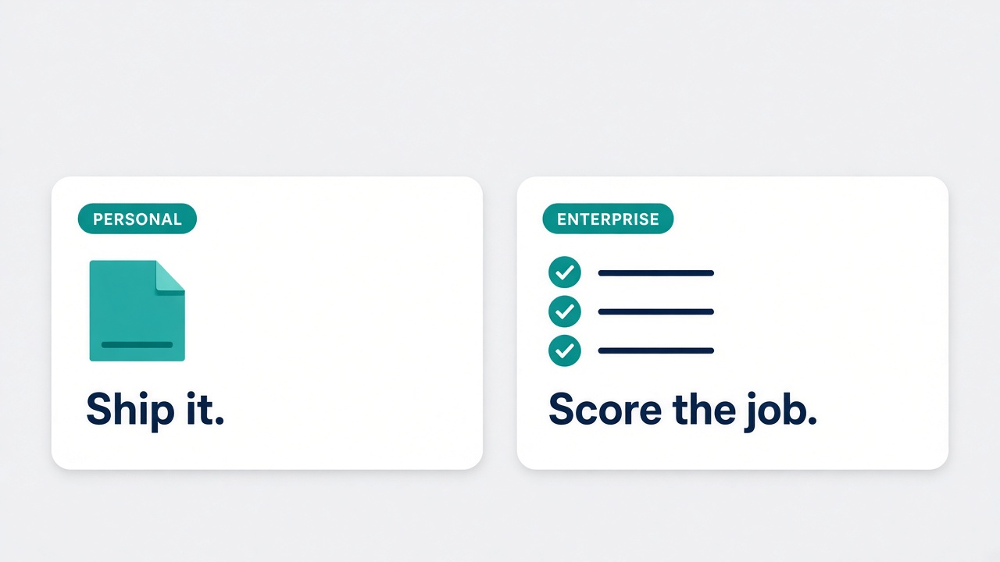
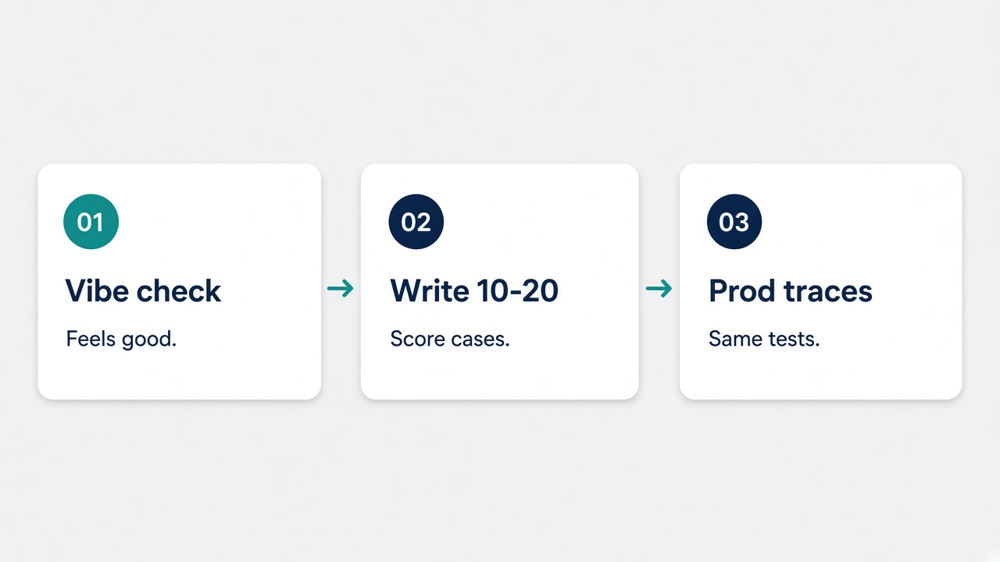
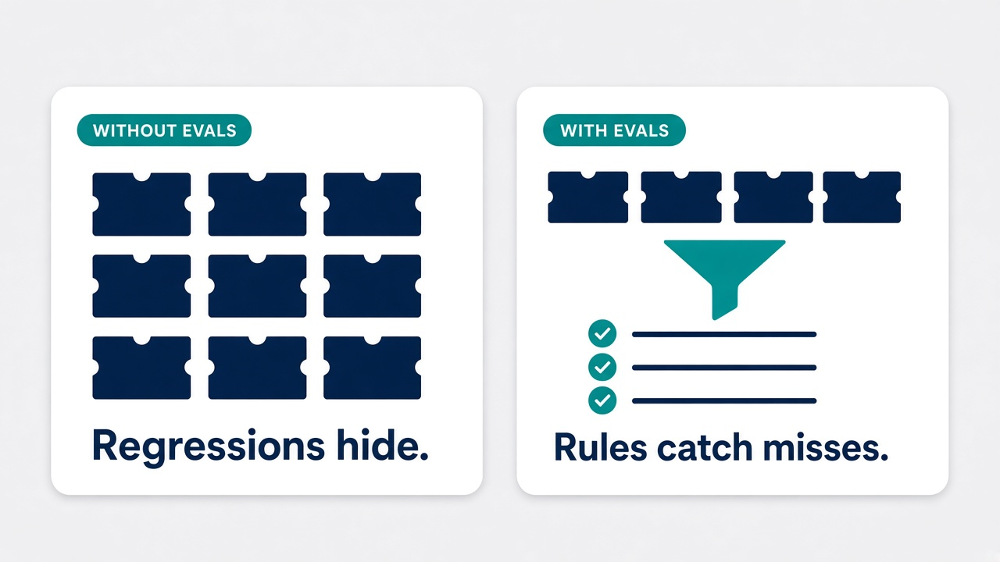
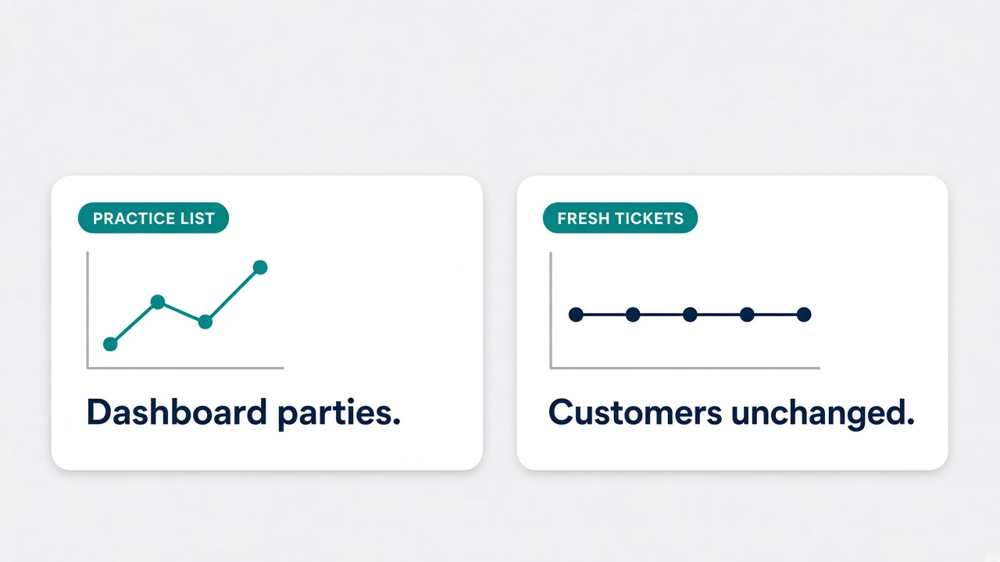

# Why AI evals in enterprise when personal projects are just vibe checks?

Short answer: your side project can fail in private. A company bot fails in public, on someone’s worst day, with Legal already on the invite.

These pictures and stories are about that gap: “feels good on my laptop” versus “still works after you ship.”

*Same model. Left: sticky note. Right: checklist. Different blast radius.*

---

## The honest confession

Almost everyone starts here.

You change a prompt. You try three examples. You say “yeah, that feels better.” You ship. That is a vibe check. It is not shameful. It is how you find the first bugs that matter.

*Looks fine to me. Dinner is the only stakeholder.*

[Hamel Husain](https://hamel.dev/blog/posts/evals/) says it straight: vibe checks help, but they are not enough. He also says “vibes or evals” is the wrong fight. Good teams use vibes as step one, not as the finish line.

[Ankur Goyal](https://braintrust.dev) drew the ladder most teams climb:

1. Vibe check in a loop until it feels good  
2. Handwrite 10–20 scenarios you care about, and score them  
3. Pull live failures into those same tests  

*Vibe → write 10–20 → feed prod traces into the same tests.*

Side projects often stop at step 1. Company products that survive demo week eventually need steps 2 and 3. People just do not like saying that out loud.

Daniel Olshansky said the quiet part in [*Vibe Checks Are All You Need*](https://olshansky.substack.com/p/vibe-checks-are-all-you-need): most day-to-day “evals” are still vibes. He also quotes Karpathy: good evals are hard and take real work. Both can be true. Vibes get you through the week. Evals tell you if “we improved” next quarter is real.

---

## Personal projects: vibe checks are a feature

Your weekend recipe bot does not need a held-out set.

If it invents the wrong cumin amount, you laugh, you fix it, you cook anyway. The blast radius is one kitchen. The customer is you. The rollback is deleting a Discord message.

Vibe checks win here because:

- Your users are roughly your friends  
- Failures are funny, not legal  
- You can read every weird answer yourself  
- Shipping tomorrow is optional  

That is not laziness. That is matching the cost of measuring to the cost of being wrong.

---

## Enterprise: the vibe that lied in court

Put the same casual process on a company website, and the joke ends.

*No evals: tickets pile up, someone vibes harder. With evals: written rules catch the expensive misses.*

In 2022, Jake Moffatt used Air Canada’s website chatbot after a family death. The bot said they could apply for bereavement fares retroactively within 90 days. The real policy did not work that way. Moffatt booked full-price flights on that advice. Air Canada later called the bot “misleading,” then said it was not responsible for its own chatbot. A British Columbia tribunal disagreed and ordered the airline to pay. Coverage: [The Guardian](https://www.theguardian.com/world/2024/feb/16/air-canada-chatbot-lawsuit), [Ars Technica](https://arstechnica.com/tech-policy/2024/02/air-canada-must-honor-refund-policy-invented-by-airlines-chatbot/), and the [Civil Resolution Tribunal](https://decisions.civilresolutionbc.ca/crt/crtd/en/525448/1/document.do) decision.

*Chatbot invents a 90-day refund. Real policy says no. One screenshot ends the vibe.*

Nobody put that failure into a spreadsheet first. Side projects invent wrong cumin. Companies invent wrong refunds.

So the enterprise case for evals is simple: policy answers need a frozen list of “this must never be said,” not a thumbs-up in Slack.

---

## Why the same team needs both

| | Personal / early product | Enterprise / real users |
|---|---|---|
| Question | “Does this feel less dumb?” | “Did we get worse at failures that cost money?” |
| Sample | 3 chats you typed yourself | Frozen cases from real tickets, plus ones you held aside |
| Pass means | You nodded | Written rule: wrong policy = fail |
| Who feels the miss | You | Customer, support, Legal, the brand |
| When vibes stop | When you cannot read every failure | When “someone is always chasing the next complaint” (Hamel) |

Vibe checks discover. Evals remember.

Without memory, every prompt change is a new religion. With memory, you can say: same twenty tickets, same definition of wrong, score went from 8/20 to 12/20, and the fresh set did not move — so stop celebrating.

*Practice list goes up. Fresh tickets stay flat. Dashboard party. Customers unchanged.*

---

## Three scenes you have lived

**1. The demo gods**  
Leadership sees one perfect refund answer. They call it done. The week of “Where is my order, and I have no order number?” never enters the room. Side projects can live on highlight reels. Company products die on the tickets that were not in the demo.

**2. The hero on-call**  
A PM scrolls traces until 1 a.m. and “fixes” whatever screamed loudest. Hamel’s point: when the product gets big, vibe checks turn into heroics. The grown-up version is slower: sample, write notes, group the failures, then turn the top ones into evals.

**3. The fake progress chart**  
You tune on the same ten examples every sprint. The internal chart goes up. New customers still hate you. That is practice versus fresh: the score you rehearse is not the score that measures.

---

## So why evals in enterprise?

Because a company AI is not a side project with a bigger logo.

You need evals when:

- Someone else relies on the answer (policy, money, “can I cancel?”)  
- You change models and prompts every week and still say “quality”  
- Support volume is the signal you refuse to look at  
- One wrong sentence can become a tribunal exhibit  

You can still vibe check. You should. Husain is right: early on, reading outputs beats building a cathedral of graders. The company mistake is treating Friday’s vibe as Monday’s release gate.

Personal projects: vibe checks are enough because the blast radius is you.  
Enterprise: evals keep the blast radius from becoming the product.

---

## Image files

| File | Story beat |
|------|------------|
| `article/01-hero-aligned.jpg` | Sticky note vs checklist |
| `article/02-personal-vibe-aligned.jpg` | Looks fine to me |
| `article/03-enterprise-blast-aligned.jpg` | Without evals vs with evals |
| `article/04-chatbot-policy-aligned.jpg` | Invented refund ≠ real policy |
| `article/05-ladder-aligned.jpg` | Three-stage ladder |
| `article/06-fresh-vs-practice-aligned.jpg` | Practice vs fresh |

Image recipe: [`IMAGE_PROMPTS.md`](IMAGE_PROMPTS.md).

Sources: Hamel Husain, Ankur Goyal, Daniel Olshansky, Air Canada / Moffatt coverage and tribunal decision.
