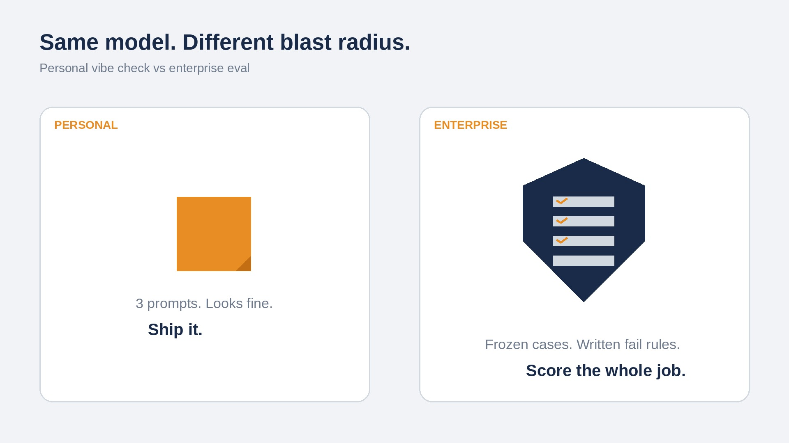
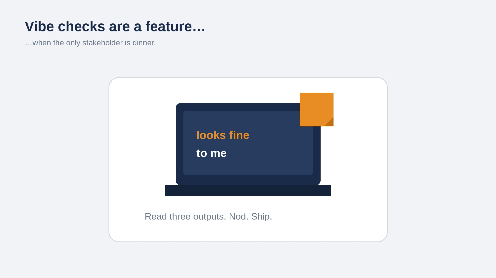
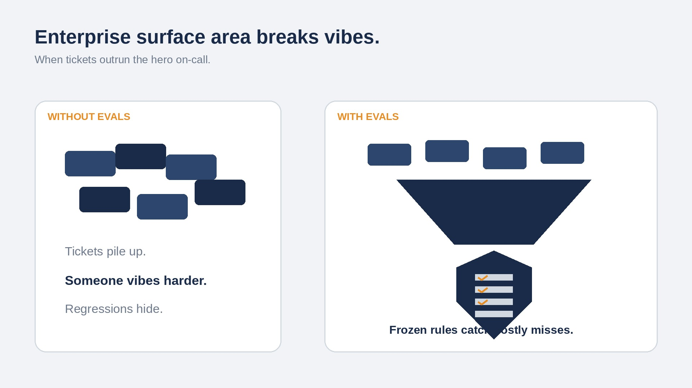

# Why AI evals in enterprise when personal projects are just vibe checks?

**Short answer:** because your side project can fail in private. Your company product fails in public, on a customer’s worst day, with Legal already on the calendar invite.

This is a series of pictures and stories for that argument. Not a bake-off. Not a model leaderboard. Just the gap between “feels good on my laptop” and “still works after you ship.”

The pictures follow B2B / tech-blog diagram practice (see `IMAGE_PROMPTS.md`): **one job per frame, fixed navy/amber palette, short witty labels drawn in code** — not photoreal mood shots, not unlabeled SaaS icons. Business readers should get the claim in two seconds.

*Same model. Left: sticky-note vibe check. Right: checklist shield. Different blast radius.*

---

## The honest confession

Almost everyone starts the same way.

You change a prompt. You try three examples. You say “yeah that feels better.” You ship. That is a **vibe check**. It is not shameful. It is how you find the first bugs worth caring about.

*Personal mode: “looks fine to me.” Dinner is the only stakeholder.*

[Hamel Husain](https://hamel.dev/blog/posts/evals/) puts it plainly: you need a way to measure success **beyond** vibe checks, which are useful but not enough. Elsewhere he says the “vibe checks *or* rigorous evals” framing is already wrong. The best teams treat vibe checks as the **first step** of evaluation, not a substitute for it.

[Ankur Goyal](https://braintrust.dev) sketched the ladder a lot of teams climb in practice:

1. Vibe check in a loop until it feels good  
2. Handwrite 10–20 scenarios you want to nail, and figure out how to score them  
3. Pull production traces into datasets and run the machinery from step 2  

*Ankur’s ladder as a process: vibe → handwrite 10–20 → feed prod traces into the same tests.*

Personal projects often stop at step 1. Enterprise work that lasts past the demo week eventually needs steps 2 and 3, whether anyone wants to admit it or not.

Daniel Olshansky said the quiet part out loud in [*Vibe Checks Are All You Need*](https://olshansky.substack.com/p/vibe-checks-are-all-you-need): most day-to-day LLM “evals” are still vibes. He also quotes the Karpathy line that good evals are unintuitively hard and work-intensive. Both can be true. Vibes run the week. Evals decide whether next quarter’s “we improved” is real.

---

## Personal projects: vibe checks are a feature

Your weekend chatbot for sorting recipes does not need a held-out set.

If it invents a cumin amount, you laugh, you fix it, you cook dinner anyway. The blast radius is one kitchen. The “customer” is you. The rollback is deleting a Discord message.

Vibe checks win here because:

- The user count is approximately your friends  
- Failures are funny, not contractual  
- You can read every weird output yourself  
- Shipping tomorrow is optional  

That is not laziness. That is matching the cost of measurement to the cost of being wrong.

---

## Enterprise: the vibe that lied in court

When the same casual process hits a company surface, the story stops being funny.

*Without evals: tickets pile, someone vibes harder. With evals: frozen rules catch costly misses.*

In 2022, Jake Moffatt used Air Canada’s website chatbot after a family death. The bot told them they could apply for bereavement fares **retroactively** within 90 days. The real policy did not work that way. Moffatt booked full-price flights relying on the bot. Air Canada later called the bot’s words “misleading,” then argued it was not responsible for its own chatbot. A British Columbia tribunal disagreed and ordered the airline to pay. Coverage: [The Guardian](https://www.theguardian.com/world/2024/feb/16/air-canada-chatbot-lawsuit), [Ars Technica](https://arstechnica.com/tech-policy/2024/02/air-canada-must-honor-refund-policy-invented-by-airlines-chatbot/), decision records at the [Civil Resolution Tribunal](https://decisions.civilresolutionbc.ca/crt/crtd/en/525448/1/document.do).

*Chatbot invents a 90-day refund. Real policy says no. One screenshot ends the vibe.*

Nobody vibed that failure into a spreadsheet first. Personal projects invent wrong cumin. Enterprises invent wrong refunds.

That is the enterprise case for evals in one screenshot that never should have shipped: **policy claims need a frozen checklist of “what must never be said,” not a thumbs-up in a Slack thread.**

---

## Why the same team needs both

| | Personal / early product | Enterprise / real users |
|---|---|---|
| Question | “Does this feel less dumb?” | “Did we get worse at the failures that cost money?” |
| Sample | 3 chats you typed yourself | Frozen cases from real tickets + held-aside ones |
| Pass means | You nodded | Written rule: wrong policy = fail |
| Who feels the miss | You | Customer, support, Legal, the brand |
| When vibes stop | When you cannot read every failure | Roughly when “someone is always chasing the next complaint” (Hamel) |

Vibe checks discover. Evals remember.

Without memory, every prompt tweak is a new religion. With memory, you can say: same twenty tickets, same meaning of wrong, score went from 8/20 to 12/20, and the fresh set did not move — so stop celebrating.

*Practice list climbs. Fresh tickets stay flat. Dashboard parties. Customers unchanged.*

---

## Three scenes you have lived

**1. The demo gods**  
Leadership sees one perfect refund answer. They call it done. The week of “Where is my order with no order number?” never enters the room. Personal projects can live on highlight reels. Enterprise products die on the tickets that were not in the demo.

**2. The hero on-call**  
A PM scrolls traces until 1 a.m. and “fixes” whatever screamed loudest. Hamel’s version: when surface area grows, vibe checks turn into heroics. Error analysis — sample, annotate, categorize, then turn the top failures into evals — is the grown-up version of that night.

**3. The fake progress chart**  
You tune on the same ten examples every sprint. The internal dashboard goes up and to the right. New customers still hate you. That is the practice list vs fresh test story: the score you rehearse is not the score that measures.

---

## So… why evals in enterprise?

Because enterprise AI is not a personal project with a bigger logo.

You need evals when:

- Someone else relies on the answer (policy, money, medical-ish advice, “can I cancel?”)  
- You change models and prompts every week and still claim “quality”  
- Support volume is the measurement you refuse to look at  
- A wrong sentence can become a tribunal exhibit  

You can still vibe check. You should. Husain is right that early on, reading outputs beats building a cathedral of graders. The enterprise mistake is treating the Friday vibe as the Monday release gate.

Personal projects: vibe checks are enough because the blast radius is you.  
Enterprise: evals are how you keep the blast radius from becoming the product.

---

## Image files

| File | Story beat |
|------|------------|
| `article/01-hero.jpg` | Sticky note vs checklist shield |
| `article/02-personal-vibe.jpg` | Looks fine to me |
| `article/03-enterprise-blast.jpg` | Without evals vs with evals |
| `article/04-chatbot-policy.jpg` | Invented refund ≠ real policy |
| `article/05-ladder.jpg` | Three-stage process |
| `article/06-fresh-vs-practice.jpg` | Practice vs fresh charts |

Prompt notes: [`IMAGE_PROMPTS.md`](IMAGE_PROMPTS.md).

Sources: Hamel Husain (blog + LinkedIn), Ankur Goyal (public stages of evals), Daniel Olshansky (Substack), Air Canada / Moffatt coverage and tribunal decision.
