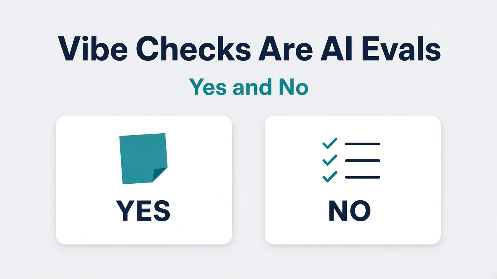
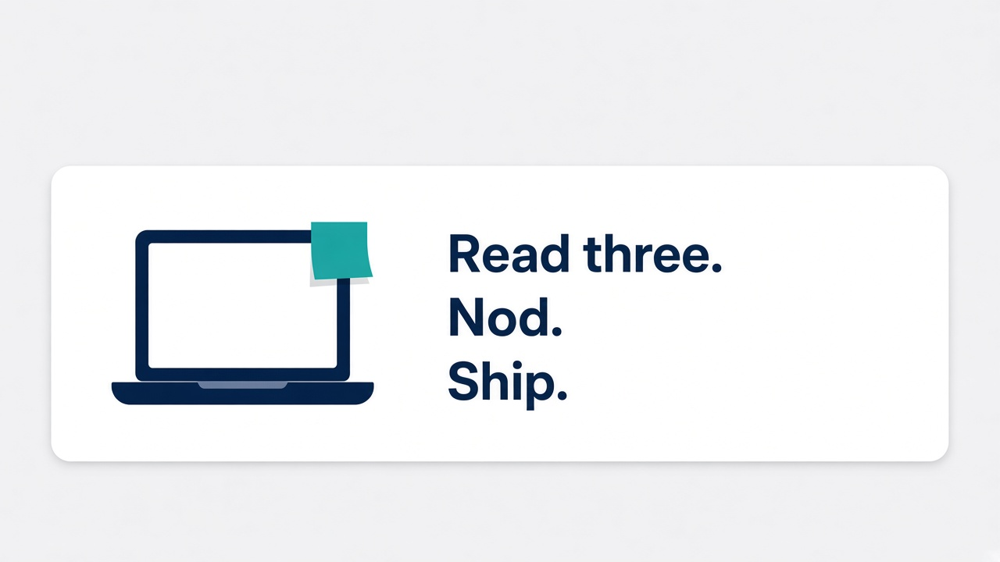
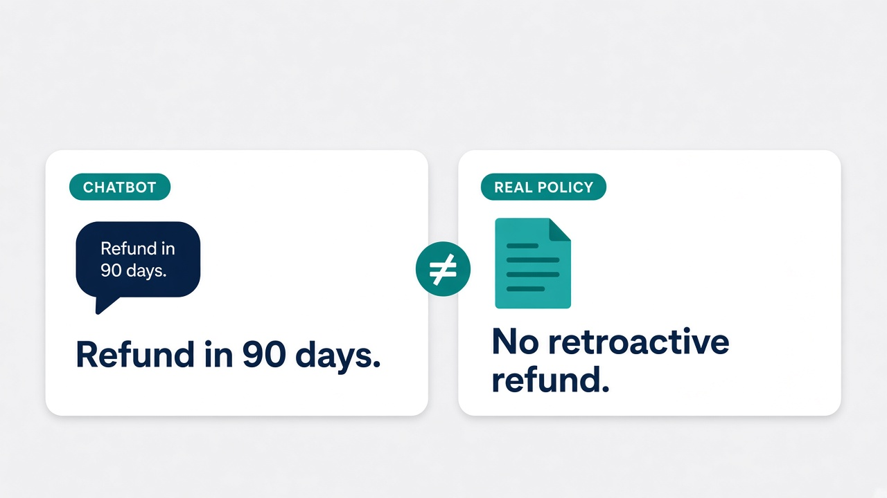

# Vibe Checks Are AI Evals. Yes and No.

*Why that answer changes when dinner stops being the only stakeholder*

Here is the short answer. Your side project can fail in private, and almost nobody notices. A company chatbot fails in public, often on someone’s worst day, and Legal is already on the calendar invite.

This article is a set of pictures and stories about that gap. It is not a tool comparison, and it is not a model leaderboard. It is about the difference between “this feels good on my laptop” and “this still works after we ship.”

*The model can be the same in both cases. On the left you only need a sticky-note vibe check. On the right you need a real checklist, because the blast radius is much bigger.*

---

## The honest confession

Almost everyone starts in the same place.

You change a prompt, you try three examples, and you say “yeah, that feels better.” Then you ship. That whole loop is a vibe check. It is not shameful. It is usually the fastest way to find the first bugs that are worth fixing.

*In personal mode, “looks fine to me” is often enough, because dinner is the only stakeholder.*

[Hamel Husain](https://hamel.dev/blog/posts/evals/) says this clearly: vibe checks are useful, but they are not enough on their own. He also says that “vibes or evals” is the wrong framing. The better teams treat vibe checks as the first step of evaluation, not as a replacement for it.

[Ankur Goyal](https://braintrust.dev) describes a ladder that many teams climb in practice:

1. You vibe check in a loop until the product feels good.  
2. You handwrite about 10–20 scenarios you care about, and you find a way to score them.  
3. You pull real failures from production into those same tests.  

*The ladder is simple: first you vibe, then you write and score 10–20 cases, and later you feed production traces into the same tests.*

Side projects often stop at step one, and that can be fine. Company products that survive the first demo week usually need steps two and three later. People just do not like admitting that part early.

Daniel Olshansky said the quiet part out loud in [*Vibe Checks Are All You Need*](https://olshansky.substack.com/p/vibe-checks-are-all-you-need): most day-to-day “evals” for language models are still vibe checks. He also quotes Karpathy’s point that good evals are hard and take real work. Both ideas can be true at the same time. Vibes help you get through the week. Evals tell you whether “we improved” next quarter is actually real.

---

## Personal projects: vibe checks are a feature

Your weekend recipe chatbot does not need a held-out test set.

If it invents the wrong amount of cumin, you laugh, you fix it, and you cook dinner anyway. The blast radius is one kitchen. The customer is you. The rollback is deleting a Discord message.

Vibe checks win in this setting for a few simple reasons:

- Your users are mostly your friends.  
- Failures are funny, not contractual.  
- You can still read every weird answer yourself.  
- Shipping tomorrow is optional.  

That is not laziness. That is matching the cost of measurement to the cost of being wrong.

---

## Enterprise: the vibe that lied in court

When you put the same casual process on a company website, the story stops being funny.

*Without evals, tickets pile up and someone just vibes harder. With evals, written rules catch the misses that cost money.*

In 2022, Jake Moffatt used the chatbot on Air Canada’s website after a family death. The bot told them they could apply for bereavement fares retroactively within 90 days. The real policy did not work that way. Moffatt booked full-price flights while relying on that advice. Air Canada later called the bot’s words “misleading,” and then argued that it was not responsible for its own chatbot. A British Columbia tribunal disagreed and ordered the airline to pay. You can read the coverage in [The Guardian](https://www.theguardian.com/world/2024/feb/16/air-canada-chatbot-lawsuit) and [Ars Technica](https://arstechnica.com/tech-policy/2024/02/air-canada-must-honor-refund-policy-invented-by-airlines-chatbot/), and the decision itself at the [Civil Resolution Tribunal](https://decisions.civilresolutionbc.ca/crt/crtd/en/525448/1/document.do).

*The chatbot invents a refund window of 90 days, while the real policy says there is no retroactive refund. One screenshot is enough to end the vibe.*

Nobody put that failure into a spreadsheet first. Side projects invent the wrong cumin amount. Companies invent the wrong refund rules.

So the enterprise case for evals is fairly simple. If the bot talks about policy, you need a frozen checklist of sentences that must never be said. A thumbs-up in Slack is not enough.

---

## Why the same team needs both

| | Personal / early product | Enterprise / real users |
|---|---|---|
| Question | Does this feel less dumb than yesterday? | Did we get worse at the failures that cost money? |
| Sample | Three chats you typed yourself | Frozen cases from real tickets, plus some you held aside |
| Pass means | You nodded | A written rule says wrong policy equals fail |
| Who feels the miss | You | The customer, support, Legal, and the brand |
| When vibes stop | When you can no longer read every failure | When someone is always chasing the next complaint (Hamel) |

Vibe checks help you discover problems. Evals help you remember them.

Without that memory, every prompt change becomes a new religion. With that memory, you can say something honest: we ran the same twenty tickets, we used the same definition of wrong, the score moved from 8 out of 20 to 12 out of 20, and the fresh set did not move, so we should stop celebrating.

*The practice list climbs week after week, while the fresh tickets stay almost flat. The dashboard throws a party, but the customers do not change.*

---

## Three scenes you have lived

**1. The demo gods**  
Leadership sees one perfect refund answer and calls the project done. The messy week of “Where is my order, and I do not even have an order number?” never enters the room. Side projects can survive on highlight reels. Company products usually die on the tickets that were missing from the demo.

**2. The hero on-call**  
A product manager scrolls traces until 1 a.m. and “fixes” whatever screamed the loudest. Hamel’s point is that when the product grows, vibe checks turn into heroics. The more grown-up version is slower: you sample outputs, you write notes, you group the failures, and then you turn the top failures into evals.

**3. The fake progress chart**  
You tune the system on the same ten examples every sprint. The internal chart goes up and to the right. New customers still hate the product. That is the practice-list story versus the fresh-test story: the score you rehearse is not the score that measures real quality.

---

## So why evals in enterprise?

Because a company AI system is not a side project with a bigger logo.

You need evals when:

- Someone else has to rely on the answer, especially for policy, money, or questions like “can I cancel?”  
- You change models and prompts every week and still claim that quality is fine.  
- Support volume is the signal you keep refusing to look at.  
- One wrong sentence can become a tribunal exhibit.  

You can still use vibe checks, and you should. Husain is right that early on, reading real outputs beats building a huge system of graders. The company mistake is treating Friday’s vibe as Monday’s release gate.

For personal projects, vibe checks are often enough because the blast radius is you.  
For enterprise products, evals are how you keep that blast radius from becoming the whole product.

---

## Image files

| File | Story beat |
|------|------------|
| `article/00-cover-vibe-evals.jpg` | Substack cover: Yes sticky note / No checklist |
| `article/01-hero-aligned.jpg` | Sticky-note vibe check versus enterprise checklist |
| `article/02-personal-vibe-aligned.jpg` | “Looks fine to me” when dinner is the only stakeholder |
| `article/03-enterprise-blast-aligned.jpg` | Working without evals versus working with evals |
| `article/04-chatbot-policy-aligned.jpg` | An invented refund that does not match real policy |
| `article/05-ladder-aligned.jpg` | The three-stage ladder from vibes to production traces |
| `article/06-fresh-vs-practice-aligned.jpg` | Practice scores climbing while fresh tickets stay flat |

Image recipe: [`IMAGE_PROMPTS.md`](IMAGE_PROMPTS.md).

For Substack copy-paste, use [`SUBSTACK.md`](SUBSTACK.md).

Sources: Hamel Husain, Ankur Goyal, Daniel Olshansky, and the Air Canada / Moffatt coverage plus the tribunal decision.
